# duilib
跨平台duilib C++ UI框架， 支持组件形式开发

## 前言

本项目将开源项目[duilib]([GitHub - duilib/duilib](https://github.com/duilib/duilib))以及[gtkduilib]([GitHub - progmboy/gtkduilib](https://github.com/progmboy/gtkduilib))两个项目的源码进行整合。提供统一接口，以便duilib能够以统一的接口运行在不同的操作系统平台以及国产化的操作系统。项目中采用了c++11标准编写代码，在涉及的常量字符串中使用u8(这是c++11的字符串常量前缀)作为前缀，表示字符串以utf8的编码方式进行内存存储。这样同一份代码无论是在windows操作系统还是linux操作系统，使用gcc还是vs或是其它编译器进行编译，字符串都是以utf8编码的格式编译到目标文件中。由于windows操作系统平台使用A和W两种版本的API函数，Linux操作系统的API默认使用utf8编码，对于操作系统API的调用在windows操作系统平台只需要utf8编码的字符串转换为UCS2，然后调用windows操作系统的W版本API如CreateWindowW、GetTextMetricsW、CreateFontIndirectW等。

## 简介

项目目标是将duilib及gtkduilib两个项目进行整合，提供统一的接口。实现一个适合windows、linux以及国产化操作系统的duilib项目，通过简单的xml就能够实现界面效果。为了实现源码能够在不同操作系统，不同的编译器进行编译的目标，所有源码文件的编码格式默认都是UTF8+BOM，这样能够保证无论使用gcc还是vs、在windows还是linux操作系统或是国产化操作系统上进行编译时都不会有编译错误。若使用其它的文件编码格式，源码中存在汉字时可能会造成不同编译器在编译过程中出现错误。

## 源码编译

源码使用cmake进行项目的代码管理。在CMakeLists.txt中会自动根据操作系统将对应的源码文件加入到源码工程中，对于cmake只要cmake版本大小3.11即可，用cmake可以生成Makefile以及vs的源码工程文件。同时要求编译器需要支持c++11特性，在编译时需要判断自己的编译器是否支持c++11特性，对于gcc工具链高于4.8.5的版本即可。目前项目所使用的编译器在windows以及linux操作系统平台下都是使用gcc编译工具链，后续支持windows下vs编译器。

### Windows编译

#### gcc编译

windows下使用mingw对项目进行编译。编译过程如下

切换到项目source目录下。

* 系统环境检查
  
  确定系统中是否支持cmake以及g++编译器。
  
  ```bat
  cmake --version
  ```
  
  输出以下信息
  
  ```bat
  cmake version 3.16.6
  
  CMake suite maintained and supported by Kitware (kitware.com/cmake).
  ```
  
  确定系统中的mingw中g++版本
  
  ```c++
  g++ --version
  ```
  
  输出如下信息，确保g++的目录被添加到系统的PATH环境变量中。
  
  ```bat
  g++ (MinGW-W64 i686-posix-dwarf, built by Brecht Sanders) 7.5.0
  Copyright (C) 2017 Free Software Foundation, Inc.
  This is free software; see the source for copying conditions.  There is NO
  warranty; not even for MERCHANTABILITY or FITNESS FOR A PARTICULAR PURPOSE.
  ```

* 编译源码
  
  执行如下命令
  
  ```bat
  mkdir build
  cd build
  cmake ../ -DCMAKE_BUILD_TYPE=Release -G "MinGW Makefiles"
  mingw32-make -j4
  ```

​    以上命令执行完成后在build目录下生成可执行文件。 双击相应的可执行文件查看demo效果。

#### msvc编译

在windows操作系统下可以使用cmake生成visual studio的sln解决方案工程。具体执行过程如下，命令行切换到source目录。执行命令

```bat
mkdir build
cd build
cmake ../ -DCMAKE_BUILD_TYPE=Release
```

以上命令执行完成后会在build目录下生成.sln文件。使用visual studio打开该解决方案进行编译即可生成可执行程序

#### 使用编译脚本（推荐）

项目提供了一键编译脚本，无需手动执行cmake命令。

**Windows平台**

执行项目根目录下的 `build_win.bat`，脚本会自动查找系统中已安装的 Visual Studio 2019/2022 并生成工程后编译。

```bat
build_win.bat              :: 默认 release 编译
build_win.bat debug        :: debug 编译
build_win.bat release      :: release 编译
build_win.bat clean        :: 清理 build 目录
```

编译产物输出到 `build/` 目录下。脚本已处理中文路径、UTF-8编码（`/utf-8`）、MSVC多配置生成器的资源路径等问题。

### Linux编译

在Linux操作系统下依赖于gtk库。所以在编译前需要确定系统中是否已安装了gtk库。以ubuntu为例，安装gtk命令如下

```shell
sudo apt install libgtk-3-dev
```

同时在Linux系统下也需要检查是否安装了cmake以及gcc编译工具链。

```shell
cmake --version
g++ --version
```

分别用于查看系统中是否安装了cmake以及g++。

**代码编译**

切换到项目source目录下执行以下命令

```shell
mkdir build && cd build
cmake ../ -DCMAKE_BUILD_TYPE=Release
make -j4
```

执行以上命令后在build目录生成可执行文件。双击或是在命令行中输入可执行文件名运行程序查看软件运行效果。

**使用编译脚本（推荐）**

项目根目录下提供 `build_linux.sh`，支持 GTK 和 X11 两种后端。

```shell
./build_linux.sh           :: 默认 GTK 后端 release 编译
./build_linux.sh x11       :: 使用 X11 后端
./build_linux.sh debug     :: debug 编译
./build_linux.sh clean     :: 清理 build 目录
```

### WSL交叉编译

在Windows上可通过WSL（Windows Subsystem for Linux）交叉编译Linux版本，无需切换到Linux环境。

**前提条件**：已在WSL中安装Ubuntu（或其他发行版）并配置好gcc/g++、cmake、gtk开发库。

**使用方法**：

```bat
build_linux_wsl.bat        :: 在Windows上调用WSL执行Linux编译
```

该脚本会调用WSL中的 `build_linux_on_wsl.sh`，自动完成以下工作：
1. 检测并安装所需依赖（通过 apt/yum/dnf 自动识别包管理器）
2. 执行cmake配置和编译
3. 将编译产物收集到 `build_linux_output/` 目录

> 注：WSL发行版需通过网络下载安装，若网络受限需先手动安装好WSL Ubuntu及编译依赖。

## 组件化框架

在原有DuiLib控件体系基础上，项目新增了一套轻量级组件化框架，支持组件注册、消息分发机制，便于构建节点式（Node）UI应用。

### 设计概述

| 类 | 职责 |
| --- | --- |
| `CNodeMessage` | 消息结构体，携带消息类型、字符串数据、任意类型数据、发送者及wParam/lParam |
| `CNodeUIBase` | 组件基类，继承`UIContainer`，构造时自动注册到管理器，析构时自动注销 |
| `CNodeUIManager` | 单例管理器，维护组件列表和消息队列，支持同步/异步消息分发 |

### 消息机制

- **发送消息**：组件调用 `PostNodeMessage(...)`，默认异步投递到管理器消息队列；设置 `b_async=false` 可同步分发。
- **接收消息**：管理器分发时只向 `WantNodeMessage()` 返回 `true` 的组件投递消息，组件在 `OnNodeMessage()` 中处理。
- **数据携带**：`CNodeMessage` 同时支持字符串数据（`msgData`）和任意类型数据（`dataPtr_`+`dataSize_`），通过模板 `GetDataAs<T>()` 取回强类型指针。
- **异步队列**：异步消息通过DuiLib定时器驱动队列处理，调用 `CNodeUIManager::ProcessMessageQueue()` 处理待发消息。

### 自定义组件开发步骤

1. 继承 `CNodeUIBase`，实现 `GetClass()` 返回唯一类名。
2. 若需接收消息，重写 `WantNodeMessage()` 返回 `true`，并在 `OnNodeMessage()` 中处理。
3. 在窗口的 `IDialogBuilderCallback::CreateControl` 中根据XML标签名创建组件实例。
4. 在XML布局中直接以类名作为标签使用，如 `<CNodeAddUI name="addNode" />`。

### 示例工程

`demo/NodeDemo/` 提供完整示例，包含两个协同组件：

- `CNodeAddUI`：加法输入节点，计算两数之和后通过 `PostNodeMessage` 发送结果。
- `CNodeResultUI`：结果显示节点，重写 `WantNodeMessage()` 返回 `true`，接收并展示计算结果。

布局XML（`NodeDemoRes/node_demo.xml`）中两个组件像普通控件一样声明，运行时由管理器自动建立消息通路。

## 效果示例

目前已将[duilib]([GitHub - duilib/duilib](https://github.com/duilib/duilib))原版本中部分示例完成了移植，在不同操作系统平台展示出一致的效果。

* windows 操作系统


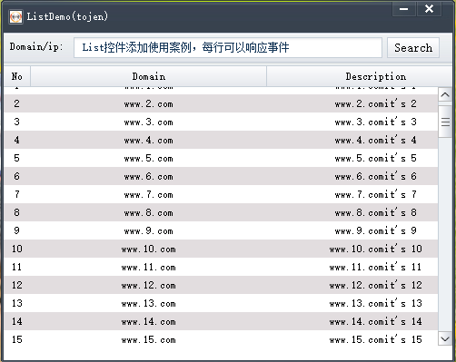
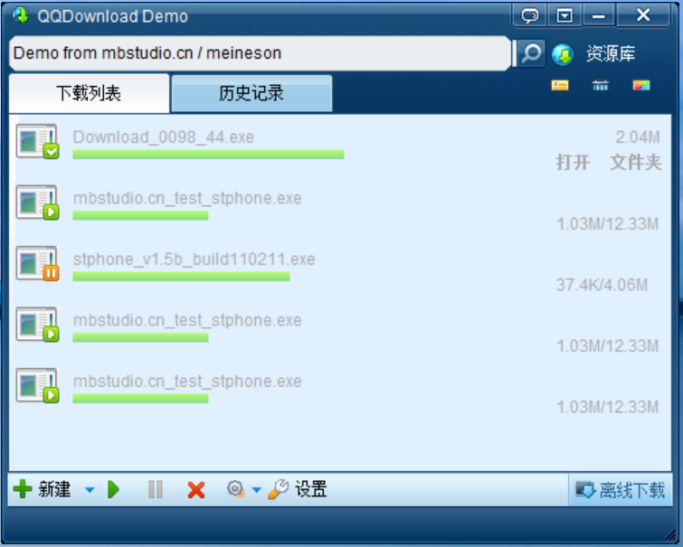
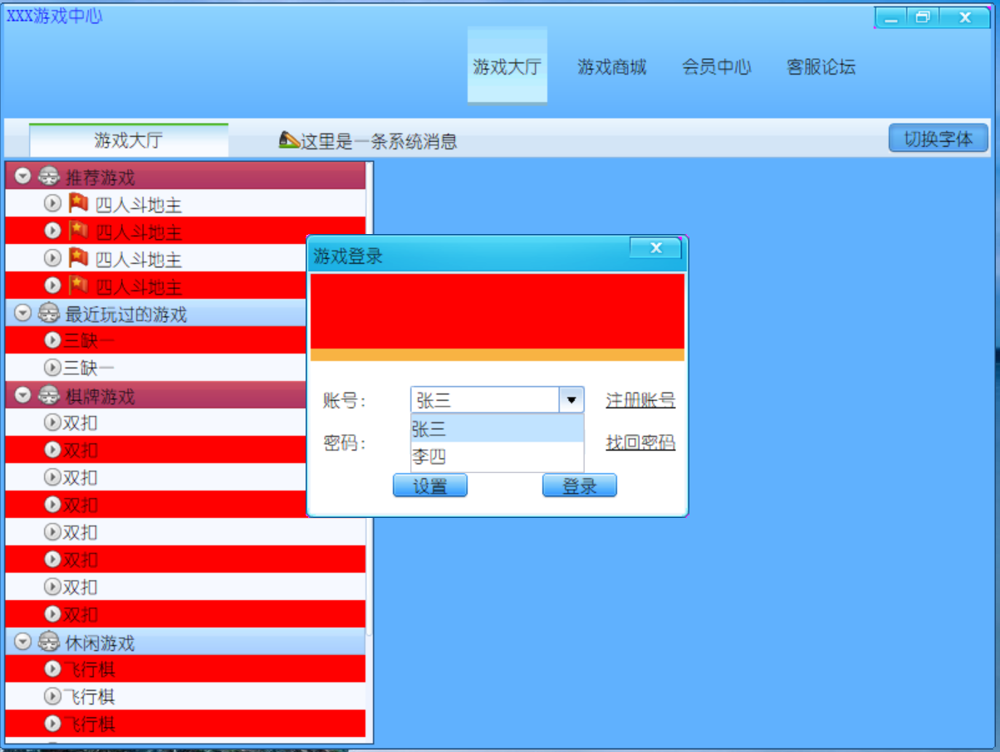

* Ubuntu 20

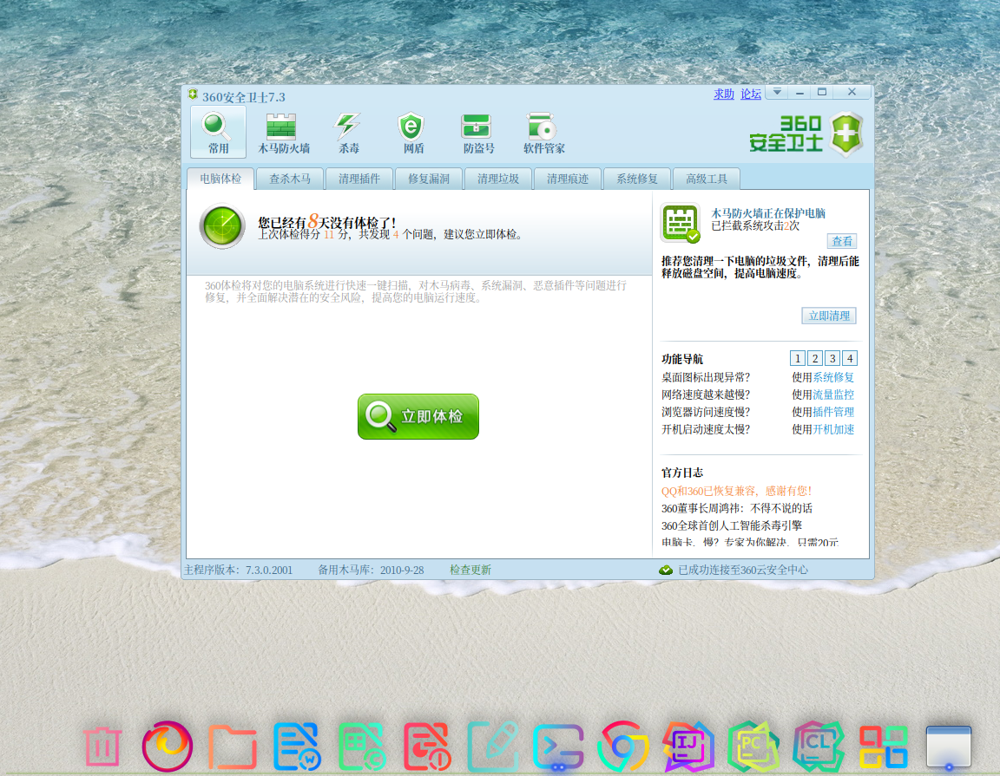
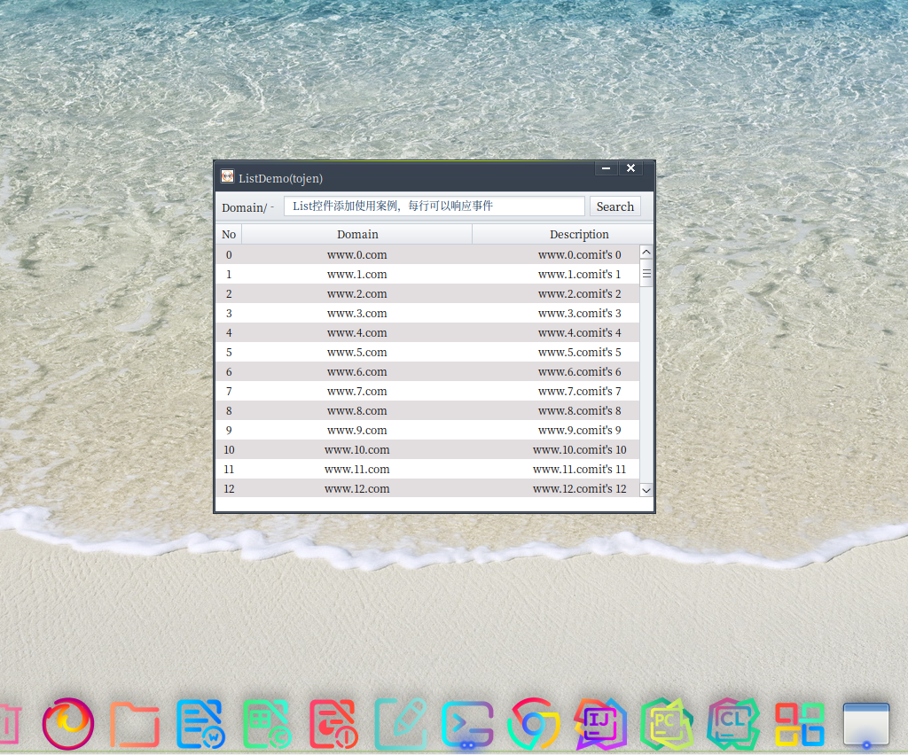
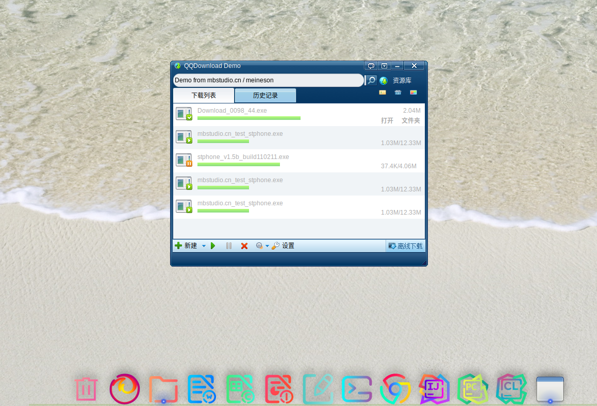
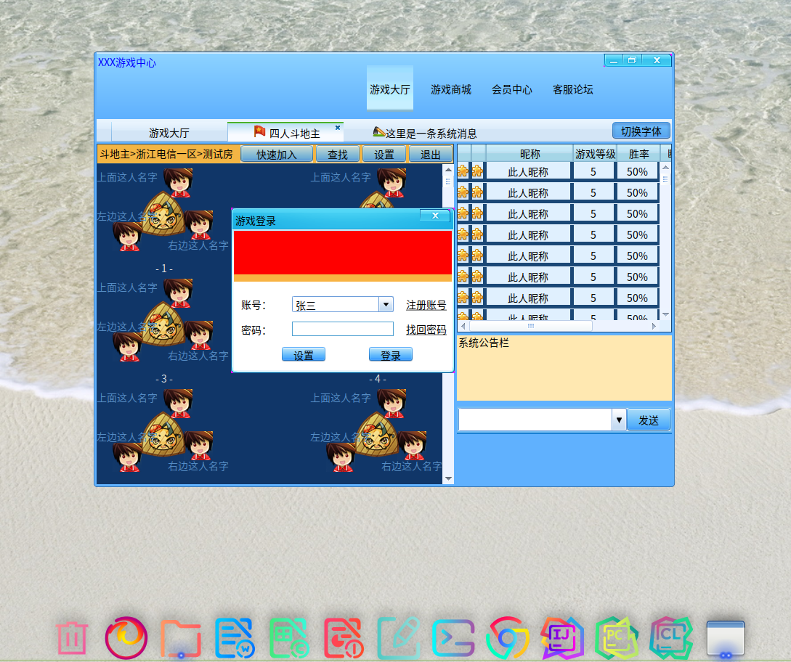

* deepin

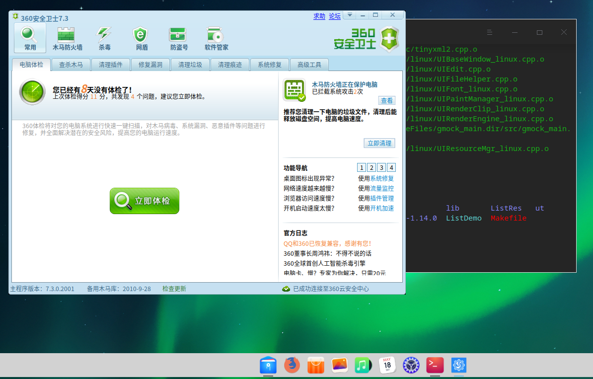
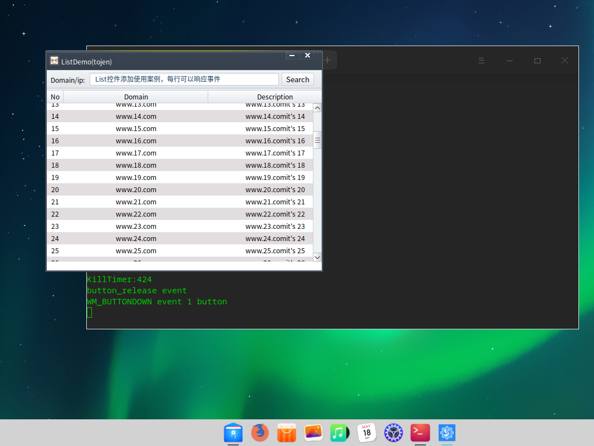

* 银河麒麟

​    

​    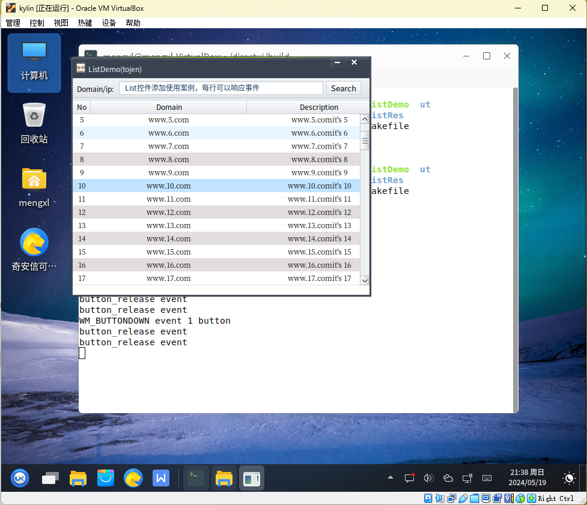

* RichEdit

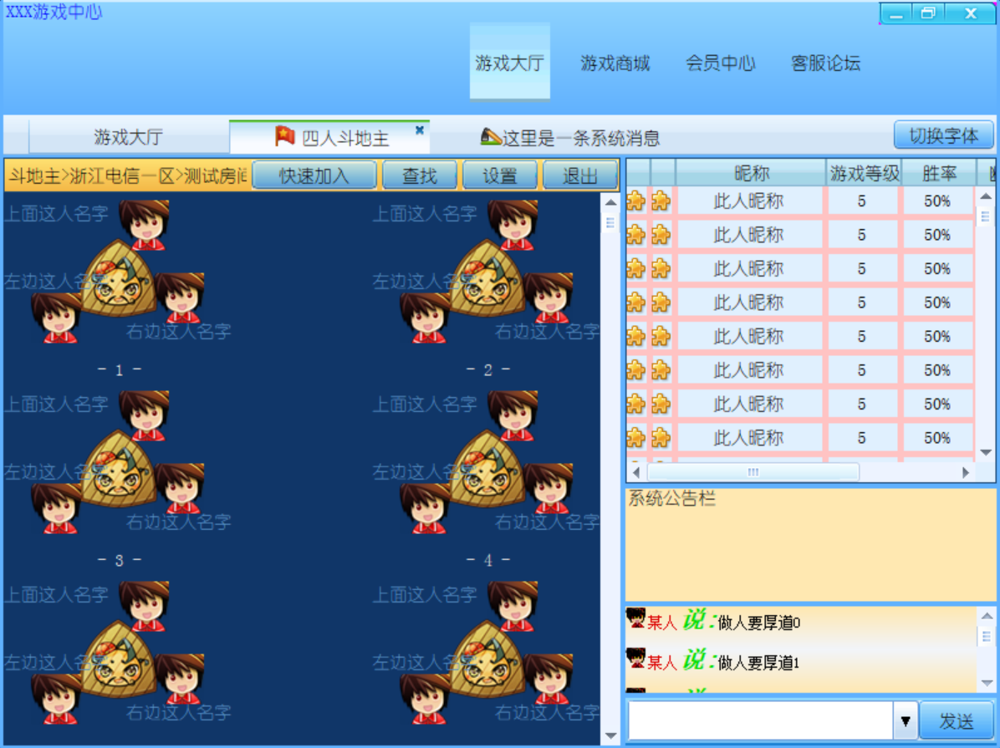

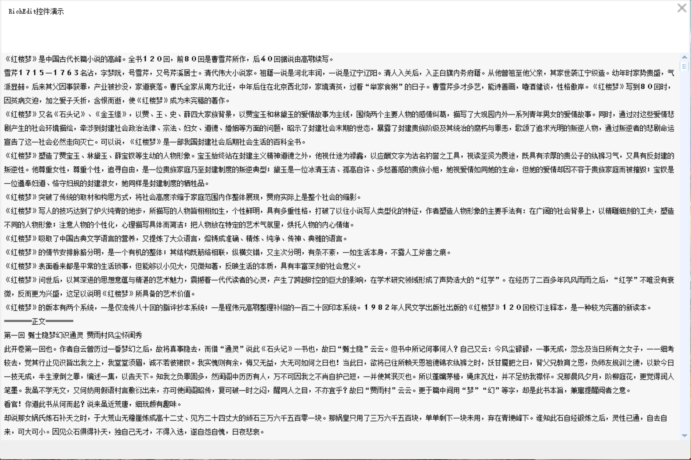

## TODO

- [ ] DrawHtml功能目前已完成window操作系统的W版本修改工作。Linux已完成DrawHtml大部分功能移植，但是对于选中文本背景色功能还未实现

- [ ] Edit控件不使用原版中的代码，使用自绘控件功能，目前windows及linux已完成Edit部分基础功能；可支持输入法输入文本，backspace删除文字、delete删除文字、home光标定位、end光标定位功能，但不支持全选以及鼠标选择范围，删除选中文字功能。

- [ ] Duilib原版本中的其它示例的移植

- [ ] RichEdit控件，增加光标定位，与Edit控件相似，增加键盘操作。

- [x] Windows MSVC编译支持（已提供 `build_win.bat` 一键编译脚本，处理中文路径、UTF-8编码、资源路径等问题）

- [x] Linux编译脚本（已提供 `build_linux.sh`，支持 GTK/X11 后端）

- [x] WSL交叉编译支持（已提供 `build_linux_wsl.bat` 和 `build_linux_on_wsl.sh`）

- [x] 组件化框架（`CNodeMessage`/`CNodeUIBase`/`CNodeUIManager`，支持组件注册、同步/异步消息分发、任意类型数据传递）

- [x] NodeDemo 组件化示例工程（`CNodeAddUI` + `CNodeResultUI` 协同演示）
